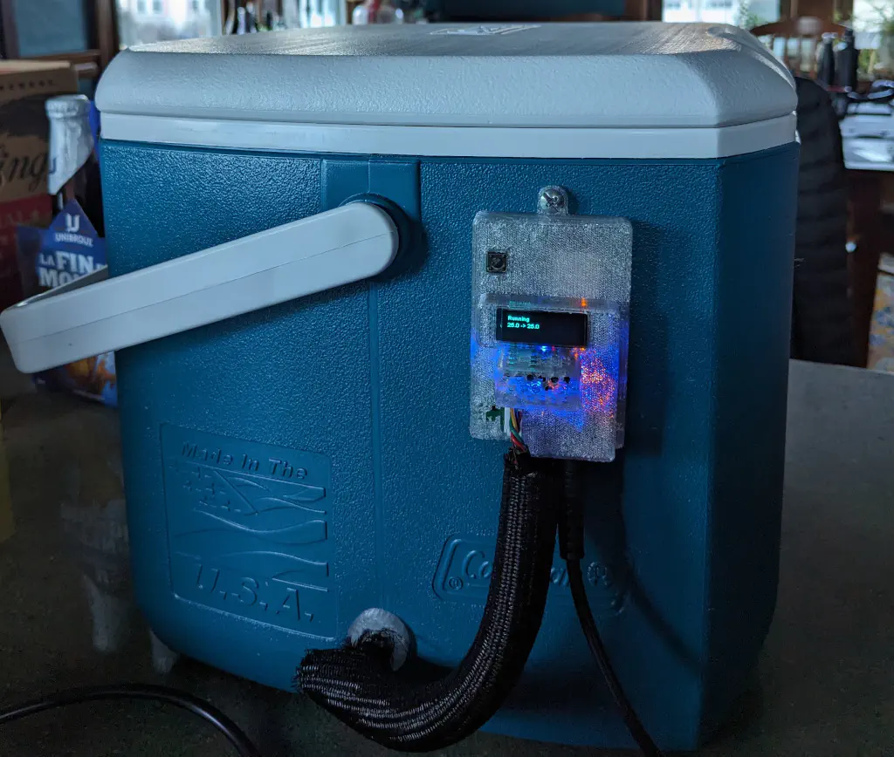
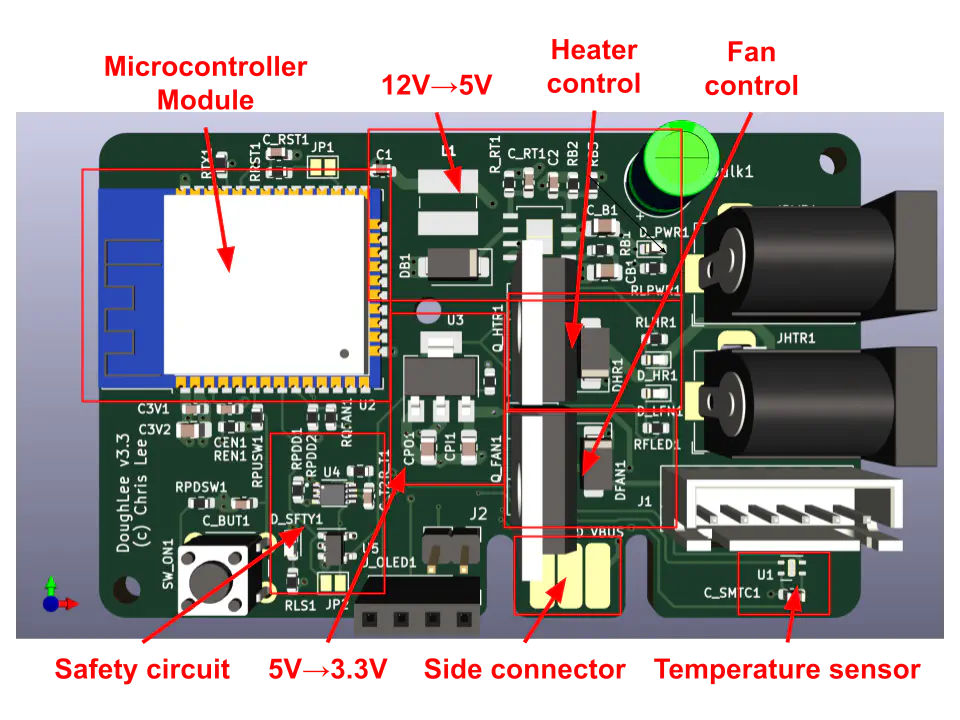
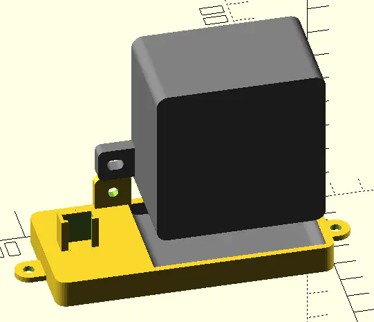
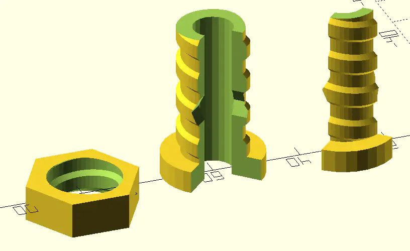

# Dough133 (v1.1.0)

Dough133 is a temperature-controlled container for proofing and fermenting sourdough.
It uses a small cooler and a PTC heater with a fan to heat the inside of the cooler.
A PCBA with an ESP32 controls the power supplied to the heater to regulate
 the temperature of the enclosure.



This repository contains:
- KiCAD design for the PCB.
- Source code for the device firmware.
- OpenSCAD design for 3D printed components.

[Instructions for the assembly](https://selectiveappeal.org/posts/dough133-assembly/)
 of the device are in this are at my blog.

Please also see the other entries describing this project:
- [Building a DIY Sourdough Proofer (Dough133)](https://selectiveappeal.org/posts/dough133/),
- [Dough133 Electronics: Designing a Custom ESP32 Controller for Proofing Sourdough](https://selectiveappeal.org/posts/dough133-electronics/), and
- [Dough133 Control: Yeast Welfare through Applied Mathematics](https://selectiveappeal.org/posts/dough133-control/).

Components needed for making this device, along with links and approximate price as of September
 2024:

| Item | Source  | Approximate cost  |
|---|---|---|
| Coleman 16 qt cooler | [Amazon](https://www.amazon.com/gp/product/B09HN13FN4) | $23 |
| PTC Air Heater 12V 100W | [AliExpress](https://www.aliexpress.us/item/3256803451720173.html) | $7 |
| DC 12V 5A Power Supply | [Amazon](https://www.amazon.com/gp/product/B01GEA8PQA)  | $12  |


## KiCAD

The circuit board design is in [KiCAD/](KiCAD/).



These require footprints in [`chl33_library`](https://github.com/chl33/chl33_library.pretty) and symbols in [`chl33_kicad_sym`](https://github.com/chl33/chl33_kicad_sym).


## OpenSCAD

Designs for 3D-printable components are in [scad/](scad/).

The EBox is based on the [ProjectBox](https://github.com/chl33/ProjectBox) OpenSCAD system.

The heater mount secures the heater and temperature/humidity sensor inside the cooler.



The Cooler plug helps avoid heat leaking through the hole through which wires run from the
 heater mount through the wall of the cooler to the EBox.



## Software

The software is based on the [og3](https://github.com/chl33/og3) library and built
 using [PlatformIO](https://platformio.org/).

### Features

*   **Modern Web Interface:** A responsive Svelte-based UI for real-time status monitoring, PID tuning, and system configuration.
*   **PID Temperature Control:** Uses a Proportional-Integral-Derivative controller with feedforward to maintain precise temperature.
*   **Manual Fan Control:** Toggle the enclosure fan manually via the web interface.
*   **Home Assistant & Adafruit IO Integration:** Supports MQTT auto-discovery for seamless integration with Home Assistant as a generic thermostat, as well as SSL/TLS and Adafruit IO broker modes.
*   **Safety Features:** Includes max/min temperature limits, sensor error detection, `WifiWatchdog` recovery, and a software-monitored `200 Hz` heartbeat pulse for the hardware safety circuit (`SN74LVC1G123`) to cut heater power if the main loop or control loop stalls.


### Getting Started

#### Prerequisites

*   [PlatformIO](https://platformio.org/install) (CLI or VSCode extension).
*   [Node.js](https://nodejs.org/) (v22+) and `npm` for building the Svelte web interface.

#### Configuration

The project uses `ini` files for local configuration and secrets. Create `secrets.ini` and `local.ini` based on the provided examples:

1.  **Secrets (`secrets.ini`):**
    Copy `secrets.ini.example` to `secrets.ini` and configure:
    ```ini
    [secrets]
    otaPassword = my_secure_password ; Password for Over-The-Air updates
    ```

2.  **Local Build & Upload Settings (`local.ini`):**
    Copy `local.ini.example` to `local.ini`:
    ```ini
    [platformio]
    default_envs = wifi              ; Use 'usb' for serial flashing or 'wifi' for OTA

    [local]
    uploadPort = 192.168.1.100       ; IP address of the board for OTA uploads
    build_flags =
        '-D LOG_UDP'
        '-D LOG_UDP_ADDRESS=192, 168, 1, 50'
    wifi_upload_flags =
    ```

#### Building and Flashing

1.  Install Svelte frontend dependencies (first time):
    ```bash
    cd svelte && npm ci && cd ..
    ```
2.  Build and upload the firmware (via USB or OTA depending on `default_envs` or `-e`):
    ```bash
    pio run -e usb -t upload   # Flash via USB (/dev/ttyUSB0)
    pio run -e wifi -t upload  # Flash via OTA
    ```
3.  Monitor the serial output to verify startup:
    ```bash
    pio device monitor
    ```

### Usage

#### Physical Interface

*   **Button:** Press the physical button to toggle temperature control ON or OFF.
*   **OLED Screen:** Displays the current state (Off, Running, Cooling), current temperature, and target temperature.

#### Web Interface

Once connected to WiFi, navigate to the device's IP address (displayed on the OLED).
*   **Status Page:** View current temperatures (Enclosure, Room), humidity, and heater status.
*   **Controls:** Enable/Disable the heater.
*   **Configuration:** Set the target temperature, ramp rates, and PID gains.

#### Home Assistant

Ensure your MQTT broker details are configured in the Web UI.
The device will automatically appear in Home Assistant as a climate device
 (Thermostat) if MQTT discovery is enabled.
